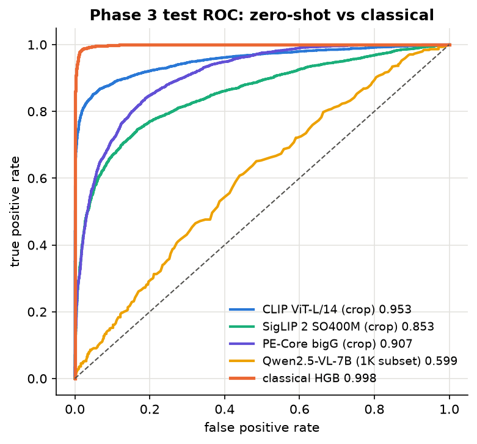
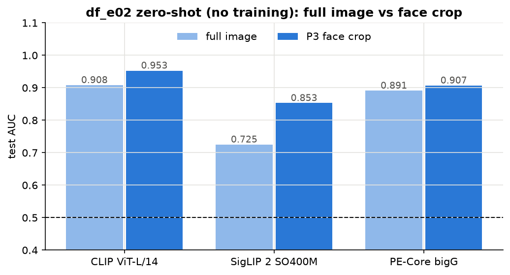
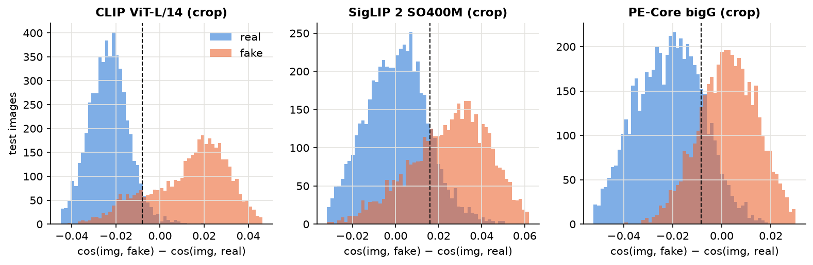
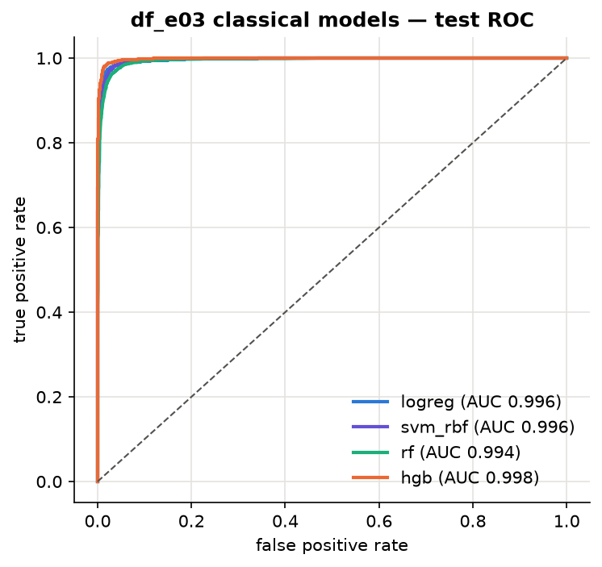
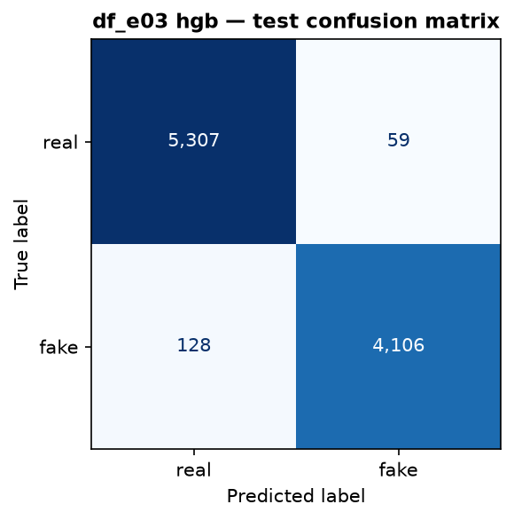
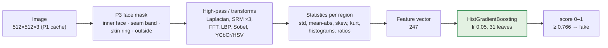
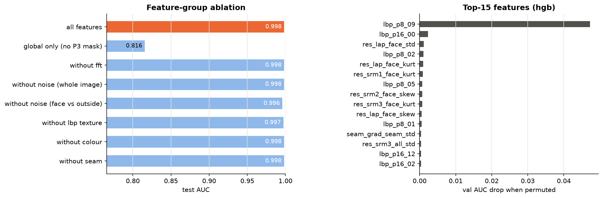
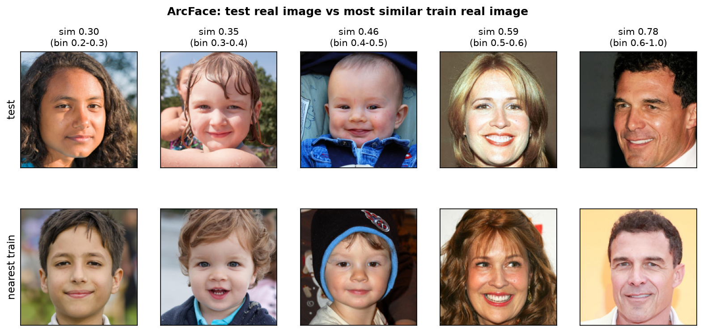

# Phase 3 — Zero-shot Models and the Classical Model

Experiments `df_e02_zero_shot` and `df_e03_classical` (+ `df_e03` leakage audit).
Covers rubric criteria 4–5 for the zero-shot and classical branches. Figures: `documents/figures/phase3/`.

**Evaluation protocol (all experiments).** Prompts, hyper-parameters and decision thresholds are
chosen on val; test is scored once. The threshold maximises val balanced accuracy. Val/test exclude
51 near-duplicate photos of train images found by the leakage audit (test C below), leaving
9,546 val and 9,600 test images.

## Headline results (test)

| Model | Training | Input | AUC | Accuracy | Precision | Recall | F1 |
|---|---|---|---|---|---|---|---|
| Qwen2.5-VL-7B (1,000-image subset) | none | full | 0.599 | 0.545 | 0.489 | 0.721 | 0.583 |
| SigLIP 2 SO400M/16-384 | none | P3 crop | 0.853 | 0.797 | 0.809 | 0.707 | 0.755 |
| PE-Core bigG/14-448 | none | P3 crop | 0.907 | 0.824 | 0.788 | 0.821 | 0.804 |
| **CLIP ViT-L/14** | none | P3 crop | **0.953** | 0.906 | 0.934 | 0.846 | 0.888 |
| **Classical: P4 features + HistGradientBoosting** | train split | full + P3 mask | **0.998** | **0.981** | 0.986 | 0.970 | 0.978 |

---

## df_e02 — Zero-shot (no training)

### Image–text models
Each image embedding is compared with the mean text embedding of a "real" and a "fake" prompt
group: score = cos(img, fake) − cos(img, real). Three prompt sets were tried on val:

| Prompt set | "real" prompts (examples) | "fake" prompts (examples) |
|---|---|---|
| basic | "a photo of a real face" | "a photo of a fake face", "a deepfake image of a person" |
| **forensic** | "an authentic, unedited photo of a face" | "a face-swapped image", "a digitally manipulated photo of a face" |
| detail | "a face with natural skin texture and realistic lighting" | "a face with unnaturally smooth skin and blending artifacts" |

The **forensic** set won on val for every model and view (`val_prompt_search.csv`).

| Model | Released | Input px | Full image AUC | **P3 face crop AUC** |
|---|---|---|---|---|
| CLIP ViT-L/14 (OpenAI) | 2021 | 224 | 0.908 | **0.953** |
| PE-Core bigG/14 (Meta) | 2025 | 448 | 0.891 | 0.907 |
| SigLIP 2 SO400M/16 (Google) | 2025 | 384 | 0.725 | 0.853 |

Findings:
- **Zero-shot works far better than expected** (0.85–0.95 AUC, not ~0.5). The words "face-swapped /
  manipulated" carry real meaning in these models' image space.
- **The P3 face crop helps every model** (+0.02 to +0.13 AUC).
- **The oldest, smallest model wins.** CLIP ViT-L/14 beats PE-Core bigG, which leads the OpenCLIP
  ImageNet zero-shot leaderboard. General recognition accuracy does not predict deepfake sensitivity.
- **Sanity check (2,000 val images, CLIP full image):** face blanked → AUC 0.499 (no background
  shortcut); background blanked → 0.628. CLIP judges the face *in context* (face vs hair, neck,
  lighting), not the face alone and not the background.
- Implementation note: PE-Core bigG runs with fp16 weights; with fp32 weights it held 15 GB and pushed
  the Mac into heavy swap.

### Vision-language chat model: Qwen2.5-VL-7B-Instruct
Run locally with MLX (8-bit). Score = log p("Yes") − log p("No") for the first answer token.
Prompt chosen on 500 val images ("forensic" 0.581 vs "direct" 0.554), test on a stratified 1,000-image
subset (559 real, 441 fake), ~3 s per image.

**Test AUC 0.599, accuracy 0.545** — barely above chance, consistent with recent studies finding
open VLMs unreliable as deepfake detectors and with HiDF's "human-indistinguishable" claim.
The yes/no answer of a chat model is far weaker than the raw embedding similarity of a contrastive model.

---

## df_e03 — Classical model

**Features:** 247 P4 features per image (`step10_extract_features.py`, ~22 min for 69K images).
**Classifiers** (`df_e03_classical.py`), hyper-parameters chosen on val AUC:

| Classifier | Search | Chosen | Val AUC | Test AUC | Acc | Prec | Rec | F1 | AUC `c*` | AUC `f*` |
|---|---|---|---|---|---|---|---|---|---|---|
| **HistGradientBoosting** | lr {0.05, 0.1} × leaves {31, 63} | lr 0.05, 31 leaves | 0.998 | **0.998** | **0.981** | 0.986 | 0.970 | 0.978 | 0.997 | 0.999 |
| Logistic regression | C {0.01 … 10} | C 10 | 0.995 | 0.996 | 0.975 | 0.984 | 0.958 | 0.971 | 0.995 | 0.997 |
| SVM (RBF), 10K subsample | C {1, 10} | C 10 | 0.995 | 0.996 | 0.972 | 0.967 | 0.970 | 0.969 | 0.993 | 0.998 |
| Random Forest (500 trees) | depth {None, 20} × leaf {1, 5} | None, 1 | 0.993 | 0.995 | 0.967 | 0.961 | 0.963 | 0.962 | 0.990 | 0.998 |

Test confusion matrix (HGB, threshold 0.766 from val): real 5,307 correct / 59 called fake;
fake 4,106 correct / 128 called real.

### Architecture (pipeline)

Only the classifier is learned; every step before it is a fixed, hand-designed formula (P3 + P4).

Feature groups (details in `PREPROCESSING.md`, P4): FFT spectrum 128 · whole-image noise 16 ·
face vs outside noise 36 · LBP texture 28 · colour 30 · seam 8 · face area 1.

### What the classical model uses

| Variant (HGB, retrained) | Features | Test AUC |
|---|---|---|
| All features | 247 | **0.998** |
| **Global only — no P3 face mask** (FFT + whole-image noise) | 144 | **0.816** |
| Without FFT | 119 | 0.998 |
| Without whole-image noise | 231 | 0.998 |
| Without face-vs-outside noise | 211 | 0.996 |
| Without LBP texture | 219 | 0.997 |
| Without colour | 217 | 0.998 |
| Without seam | 238 | 0.998 |

Permutation importance on val (AUC drop when a group is shuffled): **LBP texture 0.336**,
face-vs-outside noise 0.056, all others ≤ 0.001. Top single feature: `lbp_p8_09`, the share of
non-uniform LBP patterns inside the face, i.e. how irregular the skin micro-texture is.

Findings:
- **P3 is what makes the classical model work**: 0.816 → 0.998 when face-region features are added.
- **The cue is skin micro-texture and noise inside the face**: swapped faces are generated pixels,
  smoother and less noisy than camera skin. This matches the P4 spectrum (fakes have less
  high-frequency power) and the df_e01 face-only probe (0.98).
- No single face group is essential — removing any one costs ≤ 0.002, because LBP, face noise and
  seam features measure overlapping things.

### Leakage audit (`df_e03_leakage_audit.py`)
Because 0.998 is unusually high for a "human-indistinguishable" dataset:

| Test | Result | Verdict |
|---|---|---|
| A. Same HGB with shuffled train labels | test AUC 0.512 | No label leakage through the pipeline |
| B. HGB on background-only features (noise, LBP, colour outside the face + 20 px gap) | test AUC **0.4995** (`c*` 0.492, `f*` 0.508) | No compression / format leak, even with the strongest classical model |
| C. Near-duplicate photos across splits (16×16 normalised thumbnails, distance ≤ median fake-vs-own-base 0.098) | 24 val + 27 test images match a train photo | Real split flaw: same photo under unrelated ids (19 real↔real, 4 fake↔real, 4 fake↔fake). Effect on test AUC: none (0.9984 with or without). Flagged `near_dup` in `data/index.csv` and excluded from all evaluation |

### Person-level overlap (`step12_person_check.py`, `experiments/person_check/`)
The split keeps *image ids* apart, but the same person can appear in different photos under
unrelated ids. Every real image was embedded with ArcFace (InsightFace buffalo_l, w600k R50; 5-point
alignment from MediaPipe). Positive control on 40 fakes: similarity to their donor 0.49 (median),
to their base 0.21, to random people 0.01. Visual check: pairs ≥ 0.5 are the same person, pairs
≤ 0.46 are different people (young children are the main false matches), so the threshold is 0.5.

- **48 % of test real images** show a person who also appears in a train image (16 % of test fakes
  carry a donor face seen in train).
- **No inflation:** AUC on test images whose person is seen in train is *lower* than on unseen ones,
  for every model — classical 0.9956 vs 0.9991, CLIP 0.938 vs 0.958, PE bigG 0.911 vs 0.946,
  SigLIP 2 0.865 vs 0.894 (`seen_vs_unseen.csv`).
- **A person-disjoint split is impossible here:** adding same-person edges to the identity groups
  merges 89 % of all images into one component (face swaps chain people together; celebrities have
  many photos).
- Decision: keep the split, report the overlap as a limitation, and report seen-vs-unseen AUC for
  every Phase 4 model (deep models are the ones that could memorise faces).

**Conclusion:** the classical score is genuine for this test set. **Open risk:** the model relies on
skin texture and sensor-noise statistics, which compression, blur and resizing destroy. Its
robustness is tested in Phase 5 (`df_e09`).

---

## Implications for Phase 4

- Frozen CLIP features already separate the classes zero-shot at 0.95, so the linear probe
  (`df_e05a`) will likely be near-perfect; GenD must be judged on robustness and on its gain over
  the probe, not only on clean AUC.
- The classical model sets a very high clean-test bar (0.998). The deep models' advantage, if any,
  is expected under degradations (`df_e09`) and in which failure cases they share (Phase 5).
- Use the P3 crop as a candidate default input; `df_e07` still tests it properly on the deep models.

## Outputs

| Path | Content |
|---|---|
| `experiments/df_e02_zero_shot/emb/` | Image embeddings per model × view × split (reused by the linear probe) |
| `experiments/df_e02_zero_shot/{results,val_prompt_search,scores_test}.csv` | CLIP-style results |
| `experiments/df_e02_zero_shot/vlm_*.csv` | Qwen2.5-VL scores and result |
| `data/features_p4.parquet` | 247 classical features for all 69,476 images |
| `experiments/df_e03_classical/` | search, results, ablation, importance, test scores, leakage audit, near-duplicates |
