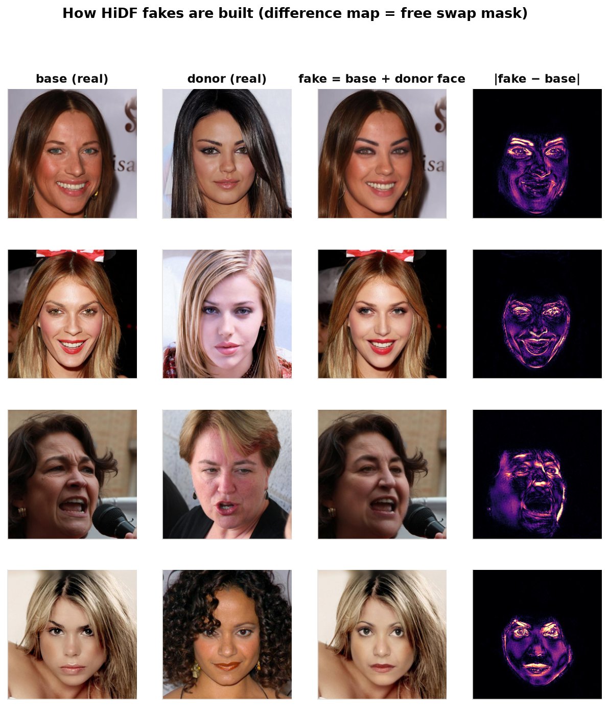
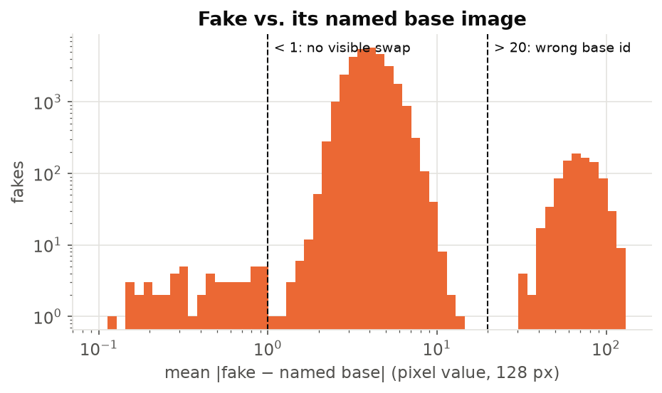
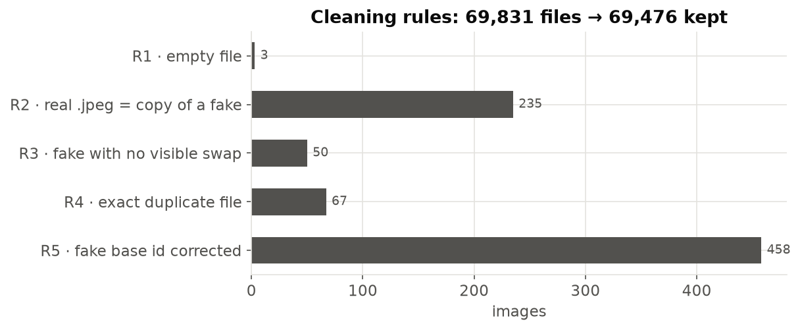
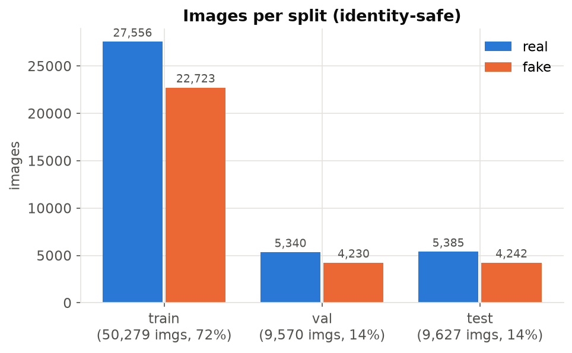
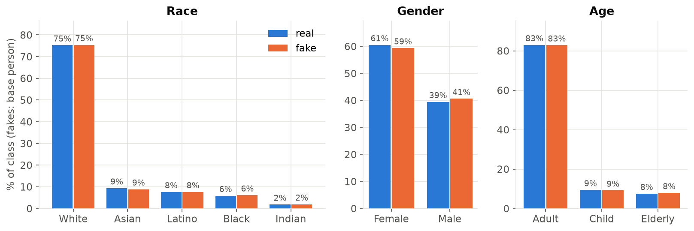
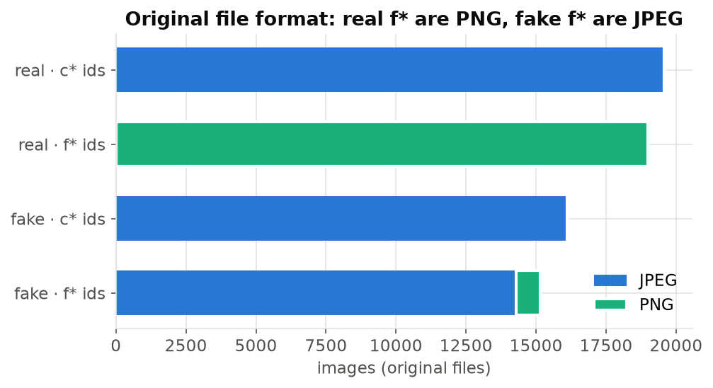
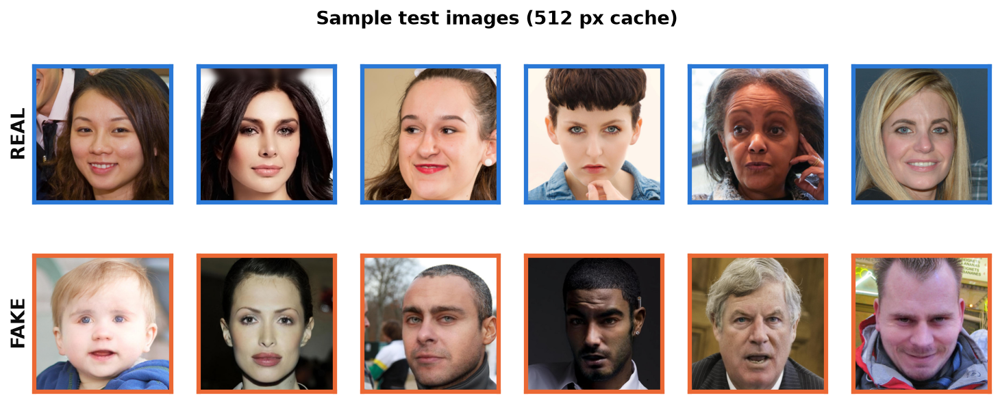

# Phase 1 — Data Cleaning, Split and Cache

Covers rubric criterion 1 (dataset + preparation) and preprocessing method **P1**.
Scripts: `src/step1_build_index.py` → `src/step6_dataset_figures.py`, run in order.
Figures: `documents/figures/phase1/`.

## 1. Dataset overview

| Item | Value |
|---|---|
| Name / source | HiDF: A Human-Indistinguishable Deepfake Dataset (Kang et al., KDD 2025), image part |
| Task | Binary classification: **real (0)** vs **fake (1)** face image |
| Image size | All 1024 × 1024 RGB, aligned faces |
| Id prefixes | `c*` (CelebA-HQ-like) and `f*` (FFHQ-like) |
| Fake type | Face swap: `Fake-img/{base_id}_{donor_id}.jpg` = scene of `base_id` with the face of `donor_id` |
| Metadata | `metadata.csv`: race, gender, age per id |
| Raw files | 38,582 real + 31,249 fake = 69,831 |
| **After cleaning** | **38,281 real + 31,195 fake = 69,476** |

`FINAL_DATASET.csv` in the dataset folder is an unrelated table (Unsplash URLs + StyleGAN3)
that matches none of the local files; it is not used.

The HiDF GitHub page lists 30,250 real / 30,250 fake images. Our copy has ~8K more real
images (mostly the face *donors*: 38,250 of the real ids are used as a base or donor of some
fake; only 290 real ids are used by no fake) and ~1K more fakes. We use everything that
passes the checks below.

## 2. Integrity checks

- **Zip vs folders**: the extracted `Real-img/` and `Fake-img/` match the zips exactly
  (same 38,582 / 31,249 names and byte sizes), so the zips (38 GB) are redundant.
- **Readability**: 3 fake files are 0 bytes. Everything else opens; 373 images are RGBA.
- **Exact duplicates (MD5)**: 285 groups of byte-identical files, explained below.
- **Fake vs its named base** (`step2_check_fakes.py`): a fake should equal its base image
  everywhere except the face. Mean absolute difference on 128 px thumbnails is 2–10 for
  normal fakes (median 4.0, ~11 % of pixels changed). Two outlier groups:
  - **mad < 1 (50 fakes)**: the swap changed nothing visible → effectively real images.
  - **mad > 20 (≈ 1.1K fakes)**: the named base is the wrong image. We recover the true
    base by matching the 6-px outer border of a 32 px thumbnail (background / hair /
    clothes, untouched by the swap). On normal fakes this finds the named base 100 % of
    the time at distance ≤ 2.5, while the 2nd-nearest image is ≥ 15 away, so < 5 is a
    confident match. 459 recovered (94 simply had base and donor swapped in the name);
    655 have no base anywhere in the dataset.

## 3. Cleaning rules

| Rule | Description | Rows |
|---|---|---|
| R1 | Drop empty (0-byte) files | 3 |
| R2 | Drop all 235 `.jpeg` files in `Real-img/`: every one is byte-identical to a fake (fakes misfiled as real — label noise). This also resolves the 42 ids that had two different real files | 235 |
| R3 | Drop fakes with no visible swap (mad < 1) | 50 |
| R4 | Drop exact duplicate files, keep the first; dropped id recorded as an alias of the kept id (`data/id_aliases.csv`) | 67 |
| R5 | Replace a wrong base id with the recovered one (rows kept) | 458 |

Kept on purpose: the 655 fakes whose real base is not in the dataset (no real counterpart
exists, so they cannot leak across splits), and 15 self-swaps (`base_id == donor_id`) that
pass the visible-change check. Metadata labels are whitespace-stripped (`"White  "`,
`"Female "`), and only `Img` rows are used.

## 4. Identity-safe split

Problem: every fake re-uses real people (its base and its donor are also real images).
A random split would put the same person in train and test and inflate the scores.

Method (`step4_split.py`):
1. Build a graph with image ids as nodes. Edges: fake `base_id — donor_id`; corrected
   fake `base_id — original named id` (conservative); duplicate `alias — kept id`.
2. Each connected component is one **group** (7,092 groups; largest 7,698 images).
3. `StratifiedGroupKFold` (20 folds, stratified on label × prefix, seed 42):
   14 folds → train, 3 → val, 3 → test.
4. Assert: no base or donor id appears in more than one split (0 leaks).

| Split | Real | Fake | Total | Share |
|---|---|---|---|---|
| train | 27,556 | 22,723 | 50,279 | 72.4 % |
| val | 5,340 | 4,230 | 9,570 | 13.8 % |
| test | 5,385 | 4,242 | 9,627 | 13.9 % |

**Update (Phase 3 leakage audit):** 24 val and 27 test images turned out to be the same photo as a
train image stored under an unrelated id (not byte-identical, so R4 missed them). They are flagged
`near_dup` in `data/index.csv` and excluded from every evaluation, leaving 9,546 val and 9,600 test
images. See `CLASSICAL_AND_ZERO_SHOT.md`.

The share is 72/14/14, not 70/15/15, because the largest groups have to go whole into one
split (all of the five largest landed in train). The fake share is 44–45 % in every split.

Demographics (of the base person) stay within ~3 points across splits:

| | train | val | test |
|---|---|---|---|
| White / Asian / Latino / Black / Indian (%) | 75.4 / 8.9 / 7.6 / 6.2 / 1.8 | 75.8 / 10.3 / 7.4 / 4.8 / 1.7 | 74.2 / 9.1 / 8.0 / 6.4 / 2.3 |
| Female / Male (%) | 60.0 / 40.0 | 61.7 / 38.3 | 58.2 / 41.8 |
| Adult / Child / Elderly (%) | 83.7 / 8.6 / 7.7 | 81.8 / 10.5 / 7.7 | 80.4 / 11.8 / 7.8 |

## 5. Preprocessing P1 — format normalisation cache

Problem: the original file format gives the label away. All real `f*` images are PNG,
all but 850 fake `f*` images are JPEG; `c*` images are JPEG on both sides (except 9 real PNGs). A model can
score high by detecting PNG vs JPEG compression instead of face-swap artifacts.

Method (`step5_build_cache.py`): every image → RGB → resize 1024 → 512 (Lanczos) →
JPEG quality 95, 4:4:4 chroma, identical for real and fake.

**Updated in Phase 2:** the leakage probe `df_e01` showed the giveaway is the whole
compression history (real `c*` q75, fakes q99, real `f*` PNG), so P1 now first re-encodes
every image as JPEG q75 at 1024 px. The final cache is `data/cache512/` (6.0 GB); this first
version is kept as `data/cache512_v1/`. See `PREPROCESSING.md`.

512 px keeps the options open for 224 / 384 / 512 model inputs and decodes ~4× faster
than the 1024 px originals.

## 6. Outputs

| File | Content |
|---|---|
| `data/raw_index.csv` | One row per original file, incl. MD5, format, size |
| `data/fake_checks.csv` | Per-fake difference to base, recovered base id, check result |
| `data/index.csv` | Clean index: label, ids, demographics, `group_id`, `split`, `cache_path` |
| `data/id_aliases.csv` | Duplicate id → kept id |
| `data/cleaning_log.csv` | Row counts per rule |
| `data/cache512/` | 512 px JPEG cache used by all experiments |
