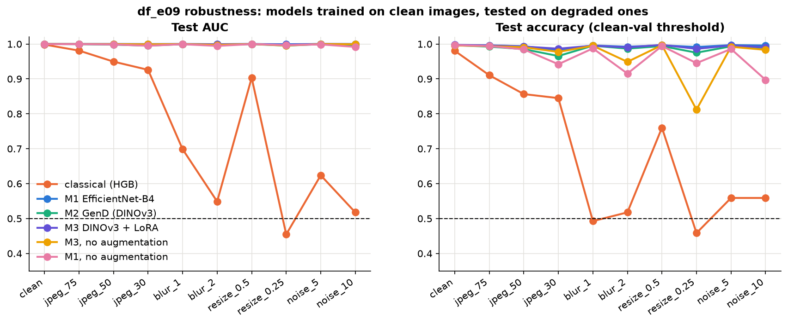

# Phase 4 — Deep-learning Models

Experiments `df_e04` (M1), `df_e05` (M2), `df_e05b` (M3), adjustments `df_e06` (augmentation off),
`df_e07` (P3 face crop), `df_e08` (higher resolution), and `df_e09` robustness for every run.
Covers rubric criteria 4–5 for the deep-learning branch (pipeline, baseline + 3 adjustments).
Figure: `documents/figures/phase4/e09_robustness.png`. Run-by-run details: `EXPERIMENT_LOG.md` 4.1–4.31.

**Evaluation protocol.** Same as Phase 3. Train on the train split. Val (minus 51 near-duplicates)
picks the best epoch and the decision threshold (max balanced accuracy). Test (9,600 images:
5,366 real, 4,234 fake) is scored once at the end. Robustness (df_e09) applies 9 degradations to
the test images and keeps the clean-val threshold.

## Headline results (clean test)

| Run | Model | Change from baseline | Trainable params | AUC | Acc | Prec | Rec | F1 | FP / FN |
|---|---|---|---|---|---|---|---|---|---|
| df_e04_effnet_b4 | M1 | baseline | 17.6 M (100 %) | 0.99987 | 99.68 % | 99.93 % | 99.34 % | 99.63 % | 3 / 28 |
| df_e05_gend | M2 | baseline | 101 K (0.03 %) | 0.99978 | 99.67 % | 99.93 % | 99.32 % | 99.62 % | 3 / 29 |
| **df_e05b_dinov3_lora** | **M3** | baseline | 12.7 M (4 %) | **0.99998** | **99.76 %** | 99.95 % | 99.50 % | **99.73 %** | 2 / 21 |
| df_e07_crop_effnet | M1 | P3 face crop | 17.6 M | 0.99990 | 99.80 % | 100 % | 99.55 % | 99.78 % | 0 / 19 |
| df_e07_crop_gend | M2 | P3 face crop | 101 K | 0.99992 | 99.69 % | 99.95 % | 99.34 % | 99.64 % | 2 / 28 |
| df_e07_crop_dinomac | M3 | P3 face crop | 12.7 M | **1.00000** | 99.79 % | 100 % | 99.53 % | 99.76 % | 0 / 20 |
| df_e06_noaug_effnet | M1 | P2 augmentation off | 17.6 M | 0.99964 | 99.68 % | 99.72 % | 99.55 % | 99.63 % | 12 / 19 |
| df_e06_noaug_gend | M2 | P2 augmentation off | 101 K | 0.99947 | 99.76 % | 99.93 % | 99.53 % | 99.73 % | 3 / 20 |
| df_e06_noaug_dinomac | M3 | P2 augmentation off | 12.7 M | 0.99992 | 99.58 % | 99.90 % | 99.15 % | 99.53 % | 4 / 36 |
| df_e08_res384_effnet | M1 | 384 px | 17.6 M | 0.99999 | 99.69 % | 99.95 % | 99.34 % | 99.64 % | 2 / 28 |
| df_e08_res384_gend | M2 | 384 px | 101 K | 0.99975 | 99.80 % | 100 % | 99.55 % | 99.78 % | 0 / 19 |
| df_e08_res_dinomac | M3 | train 320–448, eval 384 px (2 epochs) | 12.7 M | 0.99996 | 99.71 % | 99.86 % | 99.48 % | 99.67 % | 6 / 22 |

For comparison (Phase 3): classical model AUC 0.998 / acc 98.1 %; best zero-shot (CLIP) 0.953;
HiDF paper's EfficientNet-B4 (not trained on HiDF) 0.697.

**On clean images every deep run is between 99.6 % and 99.8 % accuracy.** The differences are
10–20 test images, so clean accuracy alone cannot rank the models or the adjustments. The
robustness test below is where they separate. Errors are almost all false negatives (missed
fakes): the val-chosen threshold is conservative about calling a real photo fake.

---

## Pipeline

```
HiDF image ─► P1 cache (JPEG q75 → 512 px → q95)
           ─► [P3 face crop, df_e07 only]
           ─► [P2 augmentation, training only; off in df_e06]
           ─► resize to 224 px (384 in df_e08) ─► ImageNet normalisation
           ─► model ─► fake score ─► threshold from val ─► real / fake
```

All three models share one trainer (`src/train.py`): same data loader, AdamW, linear warm-up then
cosine decay, early stopping (patience 2 on val AUC), best epoch by val AUC, same evaluation code.

**P2 augmentation (training only):** RandomResizedCrop (scale 0.8–1.0), horizontal flip,
ColorJitter 0.2 (p 0.5), GaussianBlur σ 0.1–1.5 (p 0.2), JPEG q60–95 (p 0.3),
Gaussian noise σ 0.02 (p 0.2).

## The three models

### M1 — EfficientNet-B4, fully fine-tuned (`df_e04`)
The HiDF paper's own baseline and the FaceForensics++-style supervised CNN.
- EfficientNet-B4 (Noisy Student weights, timm), all 17.6 M weights trained, BCE loss.
- lr 2e-4, weight decay 0.01, batch 32, 8 epochs, bf16. ~24 min / epoch.

### M2 — GenD on DINOv3 ViT-L/16 (`df_e05`)
Yermakov et al., WACV 2026. Parameter-efficient: the backbone stays frozen.
- Only the LayerNorm parameters + a linear head on the L2-normalised CLS token are trained:
  101 K parameters, 0.03 % of the network (matches the paper).
- Loss = BCE + 0.1 · alignment + 0.5 · uniformity (hypersphere metric learning).
- Backbone chosen by a frozen linear probe (df_e05a): DINOv3-L beat CLIP-L and SigLIP 2.
- lr 3e-4, batch 32, 5 epochs, bf16. ~51 min / epoch.

### M3 — DINOv3-L + LoRA, DINO-MAC style (`df_e05b`)
The NTIRE 2026 Robust Deepfake Detection winner (Hopf et al., team ShallowReal).
- LoRA r 32, α 64 on the q/k/v/o projections; drop path 0.1. 12.7 M trainable (4 %).
- MAC head: [CLS] + 4 register tokens + mean patch token = 6144-d → 2-layer MLP.
- Deep supervision: auxiliary heads on the last 4 layers (dropout 0.2).
- Loss = BCE + 0.5 · mean auxiliary BCE + 0.1 · supervised contrastive.
- Random training size per batch (224–320 px, random bilinear / bicubic). The paper uses
  384–1152 px; scaled down to fit our GPU.
- lr 1e-4, weight decay 0.01, warm-up 0.3 epoch, batch 16, 5 epochs, **fp32**. ~139 min / epoch.

**Training issue (M3).** The first two attempts failed: in bf16 the loss stayed flat and then
went NaN (log 4.15), and after a fix it still produced scattered non-finite steps in the bf16
forward pass (4.18). Training M3 in fp32 solved it: no non-finite step in any of its 4 runs.

---

## Adjustments (each changes one thing from the baseline)

### Adjustment 1 — P3 face crop (`df_e07`)
Input is the MediaPipe face-oval box instead of the full 512 px image, so the face fills more
of the 224 px input.
- Clean: slightly better for all three (M1 99.68 → 99.80 %, M3 → AUC 1.00000, and M1 / M3 make
  **zero** false positives).
- Robustness: best of all runs for M1 and M3 (see table below). M2 gets slightly worse under
  downscaling (×0.25: 97.5 → 96.4 %).
- Agrees with FaceForensics++: training on the face region beats the full frame.

### Adjustment 2 — augmentation off (`df_e06`)
Same models without P2.
- Clean: no change (99.6–99.8 %). Augmentation is invisible on clean test images.
- **Robustness: much worse.** This is the clearest result of Phase 4:

  | Worst condition | with P2 | without P2 |
  |---|---|---|
  | M1, noise σ10 | 99.6 % | **89.7 %** |
  | M1, blur σ2 | 99.2 % | **91.5 %** |
  | M2, JPEG q30 | 96.6 % | **80.5 %** (AUC 0.928) |
  | M2, resize ×0.25 | 97.5 % | **86.7 %** |
  | M3, resize ×0.25 | 98.6 % | **81.2 %** |
  | M3, blur σ2 | 99.0 % | 94.9 % |

- M3 without P2 still holds JPEG q30 at 97.7 %. Its random-resolution training acts as a partial
  augmentation; it does not cover downscaling to ×0.25.

### Adjustment 3 — higher resolution (`df_e08`)
M1 and M2 at 384 px; M3 trained at random 320–448 px and evaluated at 384 px.
- Clean: no meaningful gain (M1 AUC 0.99999, M2 acc 99.80 %, M3 99.71 %).
- Robustness: **worse** under the degradations that remove fine detail. M1 drops to about 96 %
  on JPEG q30, blur σ2 and resize ×0.25 (98–99 % at 224 px). M2 and M3 drop to 95.0 % at
  resize ×0.25. A model that sees more detail learns to depend on it.
- Cost: M3 ran at ~1 img/s, 13.5 h per epoch, so it was capped at 2 epochs (best epoch 0).
  M3's high-res result is therefore under-trained, but its clean AUC (0.99996) already matched
  the baseline.

---

## Robustness (df_e09, test accuracy %, threshold from clean val)

| Run | clean | JPEG 75 | JPEG 50 | JPEG 30 | blur σ1 | blur σ2 | resize ×0.5 | resize ×0.25 | noise σ5 | noise σ10 | **worst** |
|---|---|---|---|---|---|---|---|---|---|---|---|
| M1 baseline | 99.7 | 99.6 | 99.4 | 98.3 | 99.6 | 99.2 | 99.6 | 99.1 | 99.7 | 99.6 | 98.3 |
| M2 baseline | 99.7 | 99.2 | 98.5 | 96.6 | 99.5 | 98.7 | 99.4 | 97.5 | 99.3 | 98.5 | 96.6 |
| M3 baseline | 99.8 | 99.6 | 99.3 | 98.7 | 99.5 | 99.0 | 99.8 | 98.6 | 99.6 | 99.0 | 98.6 |
| M1 crop | 99.8 | 99.8 | 99.4 | 98.1 | 99.7 | 99.1 | 99.8 | 99.2 | 99.8 | 99.6 | 98.1 |
| M2 crop | 99.7 | 99.3 | 98.7 | 97.2 | 99.6 | 98.5 | 99.5 | 96.4 | 99.3 | 98.5 | 96.4 |
| M3 crop | 99.8 | 99.7 | 99.3 | 98.6 | 99.6 | 99.0 | 99.8 | 98.0 | 99.6 | 98.9 | 98.0 |
| M1 no aug | 99.7 | 99.4 | 98.5 | 94.2 | 98.7 | 91.5 | 99.4 | 94.5 | 98.6 | **89.7** | 89.7 |
| M2 no aug | 99.8 | 99.2 | 97.4 | **80.5** | 99.2 | 97.8 | 98.7 | 86.7 | 98.5 | 91.1 | 80.5 |
| M3 no aug | 99.6 | 99.4 | 99.1 | 97.7 | 99.5 | 94.9 | 99.7 | **81.2** | 99.2 | 98.3 | 81.2 |
| M1 384 px | 99.7 | 99.6 | 99.1 | 95.9 | 99.0 | 96.0 | 99.5 | 95.8 | 99.8 | 99.4 | 95.8 |
| M2 384 px | 99.8 | 99.6 | 99.3 | 98.6 | 99.7 | 98.3 | 99.6 | 95.0 | 99.6 | 99.0 | 95.0 |
| M3 320–448 px | 99.7 | 99.5 | 99.2 | 98.9 | 99.5 | 98.2 | 99.5 | 95.0 | 99.5 | 99.1 | 95.0 |
| *Classical (Phase 3), AUC* | *0.998* | *0.981* | *0.950* | *0.926* | *0.699* | *0.549* | *0.903* | *0.454* | *0.624* | *0.518* | *0.454* |

AUC stays ≥ 0.999 under all 9 conditions for M1 (baseline, crop, 384 px) and ≥ 0.997 for M3 (baseline, crop);
the drops above are mostly threshold shift, not lost ranking. The classical model falls to chance
under blur, noise and downscaling.



---

## Sanity checks

**Masking check (`check_masking.py`, all 12 runs).** The same trained model scored on test images
with the P3 face region blanked, or with everything outside it blanked.

| | original | face blanked | background blanked |
|---|---|---|---|
| Range over 12 runs (AUC) | 0.9995–1.0000 | **0.511–0.529** | 0.9945–0.9999 |

Every model is at chance without the face and unaffected without the background, so none uses a
background or compression shortcut. The P1 fix from Phase 2 holds for deep models too.

**Subgroups.** All baselines score AUC ≥ 0.9996 on both real sources (`c*` JPEG, `f*` PNG) and
on persons seen vs unseen in training (M3: 1.000 on all four), so the result is not identity
memorisation.

---

## Conclusions for the slides

1. **All three deep models solve in-dataset HiDF on clean images** (AUC ≥ 0.9995, accuracy
   99.6–99.8 %), up from 0.697 for a detector not trained on HiDF and 0.998 / 98.1 % for the
   classical model.
2. **Best model: M3 (DINOv3 + LoRA)**, baseline or face crop: best clean AUC and the highest
   worst-case accuracy (≥ 98 % under every degradation).
3. **M2 (GenD) is the efficiency winner:** 101 K trained parameters (0.6 % of M1's) for the same
   clean accuracy; it is the least robust of the three under strong JPEG and downscaling.
4. **Augmentation (P2) is what makes deep models robust.** Without it, clean results are
   unchanged but worst-case accuracy falls to 80–90 %.
5. **The face crop (P3) helps a little; higher resolution does not.** 384 px costs several times the
   compute (M3: 13.5 h vs 2.3 h per epoch) and is less robust to blur and downscaling.

**Limitations.** One seed per run (differences of < 0.1 % are within noise; bootstrap CIs are in
Phase 5). M3 trained at 224–320 px instead of the paper's 384–1152 px, and its high-res run is
capped at 2 epochs. All results are in-dataset (HiDF → HiDF).
