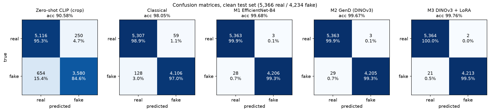
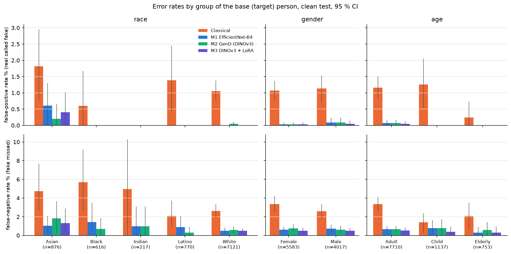
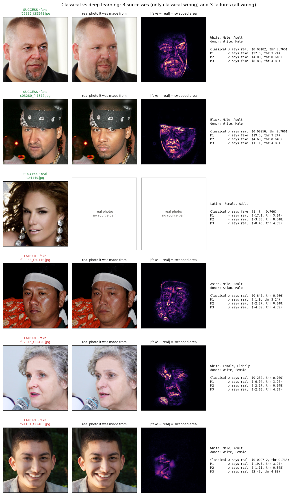
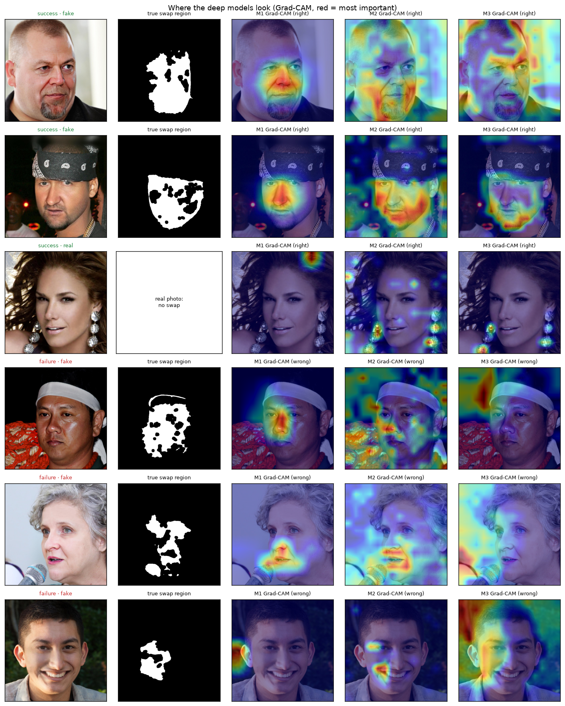

# Phase 5 — Evaluation

Experiments `df_e10_evaluation` (comparison, confusion matrices, fairness, examples; CPU, from
saved test scores) and `df_e11_gradcam` (Grad-CAM vs the real swap region; GPU, inference only).
Robustness (`df_e09`) and the masking check are reported in `DEEP_LEARNING.md`.
Covers rubric criteria 5 (metrics + confusion matrices) and 6 (3 success + 3 failure examples,
classical vs DL). Figures: `documents/figures/phase5/`. Log: `EXPERIMENT_LOG.md` 5.1–5.4.

**Test set:** 9,600 images (5,366 real, 4,234 fake) from 1,142 identity groups that never appear
in training. Thresholds were fixed on val; nothing here was tuned on test.

## 1. Comparison table (clean test, 95 % CI)

CIs come from 1,000 bootstrap resamples of **identity groups**, not single images, because
photos of the same person are not independent (an image-level bootstrap would give CIs that are
too narrow).

| Model | Trained params | AUC [95 % CI] | Accuracy [95 % CI] | Precision | Recall | F1 |
|---|---|---|---|---|---|---|
| Zero-shot CLIP ViT-L/14 (face crop) | 0 | 0.953 [0.947, 0.958] | 90.58 % [89.9, 91.3] | 93.5 % | 84.6 % | 88.8 % |
| Classical (P4 + gradient boosting) | trees | 0.9984 [0.9979, 0.9988] | 98.05 % [97.7, 98.3] | 98.6 % | 97.0 % | 97.8 % |
| M1 EfficientNet-B4 | 17.6 M | 0.99987 [0.99966, 0.99997] | 99.68 % [99.55, 99.78] | 99.9 % | 99.3 % | 99.6 % |
| M2 GenD (DINOv3) | 101 K | 0.99978 [0.99952, 0.99995] | 99.67 % [99.52, 99.81] | 99.9 % | 99.3 % | 99.6 % |
| **M3 DINOv3 + LoRA** | 12.7 M | **0.99998** [0.99997, 0.99999] | **99.76 %** [99.64, 99.87] | 99.95 % | 99.5 % | 99.7 % |

All 12 DL runs (baselines + adjustments) with CIs and paired differences:
`experiments/df_e10_evaluation/comparison.csv`, plotted in `e10_comparison.png`.

**What the CIs say.**
- Zero-shot < classical < deep learning: these gaps are far outside the CIs.
- **Between the deep models, clean accuracy does not separate them.** Every DL run lies in
  99.58–99.80 % and the CIs overlap. Paired against M1 on the same resamples, only M1 + face
  crop is clearly better in accuracy (+0.01 to +0.24 points). In AUC, M3, M3 + crop and
  M1 384 px are clearly above M1, and M2 without augmentation is clearly below, but all by
  less than 0.001.
- So the ranking of the deep models must come from robustness (`DEEP_LEARNING.md`), where the
  gaps are 2–18 points.

**Confusion matrices.** Every model's errors are mostly **missed fakes** (false negatives).
The thresholds chosen on val keep false alarms on real photos very low: 2–3 of 5,366 for the
deep models, 59 for the classical model, 250 for zero-shot CLIP.

## 2. Fairness (race, gender, age of the base person)

Error rates per group, for the classical model and the three DL baselines. FPR = real photo
called fake; FNR = fake missed. Group sizes in the test set: White 7,121, Asian 876, Latino 770,
Black 616, Indian 217 images.

| FNR (fake missed) | Asian | Black | Indian | Latino | White | Female | Male | Adult | Child | Elderly |
|---|---|---|---|---|---|---|---|---|---|---|
| Classical | **4.7 %** | **5.7 %** | 5.0 % | 2.1 % | 2.6 % | 3.4 % | 2.6 % | 3.4 % | 1.4 % | 2.1 % |
| M1 | **1.0 %** | 1.4 % | 1.0 % | 0.9 % | 0.5 % | 0.6 % | 0.7 % | 0.7 % | 0.8 % | 0.3 % |
| M2 | **1.8 %** | 0.7 % | 1.0 % | 0.3 % | 0.6 % | 0.7 % | 0.6 % | 0.7 % | 0.8 % | 0.6 % |
| M3 | **1.3 %** | 0.0 % | 0.0 % | 0.0 % | 0.5 % | 0.5 % | 0.5 % | 0.5 % | 0.4 % | 0.3 % |

- **Deep learning narrows the gaps.** The classical model misses 2–6 % of fakes depending on
  race; the DL models 0–1.8 %.
- **Asian faces are the most error-prone group overall.** They have the highest false-positive
  rate for all four models (DL 0.2–0.6 % vs ≤ 0.05 % for every other group) and the highest
  miss rate for M2 and M3 (Black is highest for the classical model and M1). The CIs overlap
  with other groups because only 876 test images are Asian, so this is a consistent trend, not
  a proven gap. It is not simply under-representation: Asian is 8.9 % of the training images,
  more than Black (6.2 %) or Indian (1.8 %), which show fewer errors. The cause is open.
- **Gender and age:** no meaningful difference for any model.
- **Cross-race and cross-gender swaps** (base and donor differ) are *not* harder for the deep
  models: M3 recall 99.8 % cross-race vs 99.4 % same-race. A swap between similar-looking
  people is what's hard (next section).

## 3. Examples: classical vs deep learning (3 successes, 3 failures)

Picked by a fixed rule from the test scores, not by hand:
- **Success** = all three DL baselines right, classical wrong (168 test images qualify). We
  took the 2 fakes and the 1 real the classical model was most confident about, i.e. its worst
  mistakes.
- **Failure** = every model wrong (classical, M1, M2, M3). Exactly 3 test images qualify.

| # | Image | Truth | Classical | M1 / M2 / M3 | Why |
|---|---|---|---|---|---|
| S1 | f02635_f25548 (White man → White man) | fake | real (0.002) | fake ✓ ✓ ✓ | A strong, full-face swap (median swap strength). The classical model reads skin micro-texture; here the swapped skin likely keeps realistic texture. The DL models see the blending of the face (Grad-CAM on nose/mouth). |
| S2 | c03280_f41315 (Black man base, White donor) | fake | real (0.003) | fake ✓ ✓ ✓ | A cross-race swap under hard light. Texture statistics look natural; the DL models focus on the swapped skin region. |
| S3 | c24149 (studio portrait) | real | **fake (1.00)** | real ✓ ✓ ✓ | Looks like a heavily retouched glamour photo: smooth, low-noise skin is exactly the classical model's "fake" cue. The DL models are not fooled by retouching. |
| F1 | f00936_f20146 (Asian man → Asian man) | fake | real | real ✗ ✗ ✗ | Donor and base look alike: swap strength at the 15th percentile of test fakes. |
| F2 | f02045_f22420 (elderly woman) | fake | real | real ✗ ✗ ✗ | Subtle swap (6th percentile), mostly around the eyes and mouth. |
| F3 | f24161_f22403 (young man, female donor) | fake | real | real ✗ ✗ ✗ | The weakest swap among all 4,234 test fakes (0.2nd percentile): only a small area on one side of the face changed. M3 came closest (score 2.43, threshold 4.89). |

"Swap strength" = mean |fake − base| over the image. The base photo is in HiDF, so this
difference is a free ground-truth mask of what the swap changed.

**What the examples show.**
- **Classical failure mode:** it equates "smooth, low-noise skin" with "fake". Retouched real
  photos trigger it, and swaps that keep natural texture pass. Combined with its collapse under
  blur and noise (`DEEP_LEARNING.md`), this cue is the classical model's main weakness.
- **Shared failure mode:** when the swap barely changes the face, nothing detects it. All
  3 all-wrong fakes are among the weakest swaps. DL misses in general have lower swap strength
  (M3: median 0.0144 vs 0.0183 for detected fakes), though across all fakes the link is weak.
- DL misses are more common on fakes built on `f*` base photos (M3 misses 0.79 % of them vs
  0.15 % of `c*`-based fakes). P1 gave both sources the same compression, so this is not a file
  format shortcut. The two sources differ in content (photo style, alignment).

## 4. Grad-CAM vs the real swap region (df_e11)

Grad-CAM heat maps for the "fake" output of each DL baseline on 300 random test fakes, compared
with the true swap region (|fake − base| > 0.05, which covers 16 % of the image on average).
M1: last conv layer (7 × 7). M2 / M3: patch tokens entering the last ViT block (14 × 14).

| | M1 EfficientNet-B4 | M2 GenD | M3 DINOv3 + LoRA |
|---|---|---|---|
| Heat inside the swap region (uniform = 16 %) | **47 %** (2.9×) | 24 % (1.5×) | 32 % (2.0×) |
| Hottest point inside the swap region (±15 px) | **91 %** | 84 % | 82 % |
| Heat inside the P3 face region (uniform = 32 %) | **88 %** | 50 % | 59 % |

- **All three models look at the swapped area**, well above chance. This is a second,
  independent confirmation of the masking check (blanking the face → AUC ≈ 0.52).
- **M1's maps are the most focused** (nose and mouth, the centre of the swap). The ViT maps are
  more spread out: transformers mix information across the whole image, and Grad-CAM on ViTs is
  known to be noisier, so lower numbers do not mean M2 / M3 use the background. The masking check
  shows they don't.
- On the 3 all-wrong fakes, M3's heat drifts to hair and background: it found nothing in the
  face to flag.

## Summary for the slides

1. **Ranking on clean images:** zero-shot (90.6 %) < classical (98.1 %) < deep learning
   (99.6–99.8 %). Among the deep models the differences are inside the 95 % CIs; robustness is
   what separates them (M3 best).
2. **Confusion matrices:** errors are almost all missed fakes; false alarms are 2–3 of 5,366
   real photos for DL.
3. **Fairness:** DL error rates are ≤ 1.9 % in every race, gender and age group. Asian faces have
   the most false alarms for every model, a trend worth reporting, though not significant at this
   sample size.
4. **Classical vs DL:** the classical model is fooled by retouched real photos and by swaps that
   keep natural skin texture; deep models handle both. Everything fails on swaps that barely
   change the face.
5. **The models look in the right place:** Grad-CAM heat is concentrated 1.5–2.9× on the
   true swap region.

**Limitations.** One training seed per model. Fairness groups other than White are small (217–876
images). Grad-CAM for ViTs is an approximation. All results are in-dataset (HiDF → HiDF).
