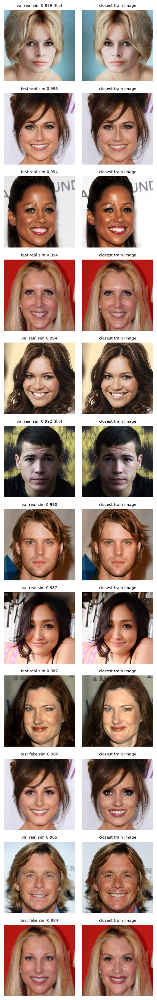

# Leakage Checks

Are the near-perfect results (deep models: test AUC ≥ 0.9995, accuracy 99.6–99.8 %) real, or
does information about the label reach the models some other way? This file collects every
possible leak, what we did about it, and what is still open. Details of each check are in the
phase documents and `EXPERIMENT_LOG.md` (entry numbers in brackets).

**Context.** Near-perfect scores are normal when a detector is trained and tested on the same
dataset (FaceForensics++ in-dataset detectors reach ~99 %). HiDF's reported ~0.70 AUC is for
detectors that were *not* trained on HiDF. So high scores alone are not proof of leakage, but
they are a reason to check.

**Status key:** ✅ controlled and tested · ⚠️ partly tested / found but harmless

## Summary

| # | Possible leak | Status | Key evidence |
|---|---|---|---|
| A1 | Same identity ID in train and test | ✅ | Identity-group split, 0 IDs across splits [1.6] |
| A2 | Same person under different IDs | ✅ | 48 % of test reals have a look-alike in train; on a strictly person-unseen subset accuracy is unchanged (T3) [3.10, 5.6] |
| A3 | Same photo under two IDs (near-duplicates) | ⚠️ found, no effect | 51 excluded [3.7]; DINOv3 audit found 42 more test images (0.44 %), removing them changes accuracy < 0.01 pt (T4) [5.9] |
| A4 | A fake shares its background with its base photo | ✅ | Base and its fakes always in one split [1.6] |
| A5 | Fakes stored as "real" | ✅ | 235 byte copies removed [1.5] |
| B1 | File format / compression history | ✅ | File size alone: AUC 0.987 → after P1, background-only probe 0.507 [2.5, 2.7, 3.7] |
| B2 | Compression mismatch **inside the face** | ✅ | Real photos given a fake-like history are flagged 0–0.1 %, same as untouched (T1) [5.8] |
| B3 | Image size, metadata | ✅ | All images 1024 × 1024; cache strips metadata |
| B4 | Global colour / noise | ✅ | Background-only classical model AUC 0.4995 [3.7] |
| B5 | Face position / size differs between real and fake | ✅ | Geometry-only classifier AUC 0.54 (T2) [5.7] |
| B6 | Reals chosen as bases differ from other reals | ✅ | Same scores for base / donor-only / unused reals (T2) [5.7] |
| B7 | Model uses the background | ✅ | Masking check, all 12 DL runs: face blanked → AUC 0.51–0.53 [4.11 …4.31]; Grad-CAM on the swap [5.4] |
| C1 | Thresholds / epochs tuned on test | ✅ | All chosen on val; test scored once per run |
| C2 | Picking the best model after seeing test | ⚠️ | Small: deep models are tied within 95 % CIs [5.1] |
| C3 | Pipeline bug passes the label | ✅ | Label shuffle: classical 0.512 [3.7], M2 0.486 (T5) [5.10] |
| D1 | Backbone pretraining saw HiDF's real photos | ⚠️ | Can't be tested directly; would only affect reals |
| E1 | All fakes from one swap pipeline (not leakage, limits generalisation) | — | Needs a cross-dataset test; stated as a limitation |

---

## A. Same content in train and test (split leakage)

The danger: the model memorises *who* or *which photo* instead of learning what a swap looks
like. HiDF fakes are named `base_donor` (donor's face pasted onto the base photo), which creates
three memorisation routes:
- **Donor:** if donor D's fakes are in train (labelled fake), the model can learn "D's face = fake"
  and get D's test fakes right by face recognition.
- **Base photo:** fakes `A_D` (train) and `A_E` (test) share the same background, hair and pose;
  the model can recognise the scene.
- **Real person:** if person X appears in train only as real, "X = real".

### A1 — Same ID across splits ✅ [1.6, `DATA_CLEANING.md`]
Every fake, its base, its donor and known alias IDs are joined into one group
(union-find), and whole groups are assigned to train / val / test with `StratifiedGroupKFold`.
7,092 groups, 72 / 14 / 14 %. Assertion: **0 IDs appear in more than one split.**

### A2 — Same person under different IDs ✅ [3.10, 5.6, `experiments/person_check/`]
A celebrity can appear as two unrelated IDs (e.g. `c00123` and `f04567`); the ID-based split
can't see that.
- ArcFace face embeddings of all 38,257 reals. Positive control: a fake is close to its donor
  (0.49) and base (0.21), random pairs 0.01, so the embedding works.
- **48 % of test real images have a same-person photo in train** (similarity ≥ 0.5).
- A fully person-disjoint split is not possible: merging same-person matches creates one
  component holding 89 % of all images.
- Impact check, test AUC on seen vs unseen persons:

  | Model | Seen person | Unseen person |
  |---|---|---|
  | Classical | 0.9956 | 0.9991 |
  | CLIP zero-shot (crop) | 0.938 | 0.958 |
  | M1 EfficientNet-B4 | 0.99998 | 0.99983 |
  | M2 GenD | 0.99996 | 0.99972 |
  | M3 DINOv3 + LoRA | 0.99999 | 0.99998 |

  Memorisation would make seen persons clearly easier. For the classical and zero-shot models
  seen persons are *harder*; for the DL models the gap is ≤ 0.0002. No sign that person overlap
  drives the scores. Open: the 0.5 threshold may call some true matches "unseen" (see test T3).

### A3 — Near-duplicate photos ⚠️ [3.7, 5.9: 42 more found by T4, no effect]
The same photo stored under two IDs. Every val/test image was compared with every train image
on 16 × 16 thumbnails; the cut-off is the median distance between a fake and its own base (same
scene, only the face differs). **24 val + 27 test** images matched and are flagged `near_dup`,
excluded from every evaluation. Retraining the classical model without them changed nothing.
Limit: thumbnails miss flips, crops and heavy edits (see test T4).

### A4 — Shared backgrounds ✅ [1.6]
A fake's background *is* its base photo's pixels. Base and fakes are in one group, so they are
always in the same split.

### A5 — Fakes stored as reals ✅ [1.5]
All 235 `.jpeg` "real" files were byte-identical copies of fakes; removed.

## B. The label leaks through something other than the swap (shortcuts)

### B1 — File format and compression history ✅ [2.5–2.7, `PREPROCESSING.md`]
The biggest leak found. Original files: real `c*` = JPEG q75, real `f*` = PNG, fakes = JPEG q99.
File size alone gave **AUC 0.987**, and even the background (base pixels) predicted the label
(0.647). Fix **P1**: every image re-encoded the same way (JPEG q75 at 1024 px → 512 px → q95).

| Probe (val AUC) | Original files | After P1 |
|---|---|---|
| File size | 0.987 | 0.639 (left over from the smoother fake face) |
| **Background only** (noise outside the face) | **0.647** | **0.507** |
| Face only | 0.997 | 0.978 |

Confirmed later with the strongest classical model on background-only features: **0.4995** [3.7 B].

### B2 — Compression mismatch inside the face ✅ (tested by T1: not used)
The real photo's face was JPEG-compressed twice (original q75, then P1). A fake's face is newly
generated pixels saved at q99, then P1, so its compression history differs, while its background
matches the reals. This mismatch lives inside the face, so the masking check and the background
probe cannot rule it out.

Part of this is a genuine forensic cue (a pasted face never matches the rest of the image), but
the q99-vs-q75 part is specific to how HiDF was saved.

Indirect evidence that the models don't depend on it:
- They stay ≥ 98 % accurate (M1, M3) after JPEG q30, blur and ×0.25 downscaling, which destroy
  fine compression traces [`DEEP_LEARNING.md`].
- On fakes built on `f*` bases (PNG, never JPEG-compressed before), M3 still detects 99.2 % of them,
  though it misses more of them (0.79 % vs 0.15 % for `c*`-based fakes) [5.3].
- Proposed direct test: T1.

### B3 — Size and metadata ✅
All images are 1024 × 1024 RGB; the P1 cache is re-encoded from pixels, so no EXIF or file
information reaches the model. The loader only reads pixels; the label comes from the index.

### B4 — Global colour or noise ✅ [2.7, 3.7]
Colour statistics are part of the background-only feature set (0.4995). Colour jitter in P2
also stops the deep models from relying on exact colour.

### B5 — Face position and size ✅ (tested by T2: AUC 0.54)
The swap tool may align, crop or resize faces differently from the original photos, so the
face box alone might separate the classes. Proposed test: T2.

### B6 — Which reals became bases ✅ (tested by T2: no difference)
If HiDF's authors picked bases with e.g. frontal faces or high quality, then "photo type"
(not the swap) could separate reals from fakes. Proposed test: T2.

### B7 — Background use by the deep models ✅ [4.11, 4.12, 4.17–4.26, 4.31, 5.4]
**Masking check** on all 12 DL runs: the same trained model scored with the face (+ safety band)
greyed out, or with everything outside the face greyed out.

| | Original | Face blanked | Background blanked |
|---|---|---|---|
| Range over 12 runs (AUC) | 0.9995–1.0000 | **0.511–0.529** | 0.9945–0.9999 |

**Grad-CAM vs the real swap region** (300 test fakes): heat inside the swapped area is 1.5–2.9×
what a uniform map would give; the hottest point lies in it 82–91 % of the time [5.4].
Both say the models read the swapped face.

## C. How we evaluated

- **C1 ✅** Best epoch and decision threshold are chosen on val. Test is scored once per run.
- **C2 ⚠️** We compared 12 runs on test. Picking a winner this way is slightly optimistic, but
  the 95 % CIs (identity-group bootstrap) show the deep models are statistically tied on clean
  test anyway [5.1], so the conclusions don't depend on the pick.
- **C3 ✅** Label-shuffle control: the classical model trained on shuffled labels gives **0.512**
  [3.7 A], so its pipeline doesn't pass the label. Repeated for M2 in T5: 0.486.

## D. Pretraining
- **D1 ⚠️** DINOv3, CLIP and EfficientNet (JFT) were pretrained on large web image sets that
  may contain some of HiDF's real celebrity photos. This can only make *reals* familiar, not
  carry the fake label, and the frozen features were already strong zero-shot (CLIP 0.953).
  No direct test is possible.

## E. Not leakage, but limits what the scores mean
- **E1** All fakes come from one face-swap pipeline, so the models may learn that pipeline's
  fingerprint. In-dataset scores say nothing about other generators. Only a cross-dataset test
  answers this (test T6). Stated as a limitation.

---

## Proposed tests for the open items (run 2026-11-01, results below)

| Test | Covers | Idea | Cost |
|---|---|---|---|
| **T1 Compression-only fakes** | B2 | Take real test photos and give only the face region a fake-like history (no swap), then score them. If models call them fake, they rely on compression, not the swap. | CPU to build, ~1 min GPU |
| **T2 Geometry + base selection** | B5, B6 | (a) small classifier on face-box position/size only; (b) compare model scores of reals used as bases vs reals never used | CPU, minutes |
| **T3 Stricter person-disjoint subset** | A2 | AUC on test images with no train match even at a lower similarity threshold (0.3) | CPU, existing data |
| **T4 Embedding near-duplicate audit** | A3 | Redo the audit with DINOv3 embeddings (robust to crop / flip / edits) | CPU / short GPU |
| **T5 Label shuffle for a deep model** | C3 | Train M2 for 1 epoch on shuffled labels → should give AUC ≈ 0.5 | ~1 h GPU |
| **T6 Cross-dataset** | E1 | Score another deepfake dataset | needs external data |

## Test results (df_e12, 2026-11-01)

### T1 — Compression-only fakes (B2) ✅ [5.8]
2,000 real test photos (1,000 `c*` camera JPEG, 1,000 `f*` PNG) re-processed from the raw files
with fake-like history, then the normal P1 step, then scored. No face was swapped.

| Variant (then JPEG q99 4:2:0 → P1) | Classical | M1 | M2 | M3 |
|---|---|---|---|---|
| untouched (raw → P1; reproduces the cache pixel for pixel) | 1.10 % | 0.0 % | 0.10 % | 0.0 % |
| q99 re-save (the fakes' save step) | 1.10 | 0.0 | 0.10 | 0.0 |
| face re-sampled (old JPEG grid wiped inside the face) | 1.05 | 0.0 | 0.10 | 0.0 |
| face + noise σ 1 (old quantisation wiped, no smoothing) | 0.85 | 0.0 | 0.10 | 0.0 |
| whole image re-sampled (control) | 1.10 | 0.0 | 0.10 | 0.0 |
| *face blur σ 1 (smoothness probe, not compression)* | ***23.05*** | *0.0* | *1.25* | *0.35* |

% = real photos called fake at the val threshold. Every variant changes the image by < 1 grey
level on average. Median scores move ≤ 0.4 % of the way from "typical real" to "typical fake".

- **The deep models ignore the face's compression history.** Their outputs don't change.
- The test *can* catch a shortcut: a light face blur makes the classical model call 23 % of real
  photos fake (33 % of `f*`). That is its known "smooth skin = fake" cue (see `EVALUATION.md`).

### T2 — Face geometry and base selection (B5, B6) ✅ [5.7]
- Gradient boosting on face-box centre / size / area only: **test AUC 0.538** (chance 0.5).
  Adding the 36-point face-oval shape: 0.610; the shape partly comes from the donor, i.e. the
  swap itself.
- A fake's face box is 1–3 px (median, at 512 px) from its own base photo's box.
- Test reals used as bases (4,181), donor only (1,144) and unused (41) get the same scores and
  false-positive rates from every model (M3 AUC vs all test fakes 0.99998 / 0.99998 / 1.0).
  Geometry tells base from non-base reals at only 0.595.

### T3 — Strictly person-unseen test subset (A2) ✅ [5.6]
A test image counts as unseen when its own face, and for a fake also its base and donor, have
ArcFace similarity below t to every train real. (At t = 0.2 nothing is left: with ~27K train faces
the nearest one is always ≥ 0.20 by chance.)

| Threshold | Unseen images (real / fake) | Classical | M1 | M2 | M3 | M3 on "seen" |
|---|---|---|---|---|---|---|
| 0.5 | 2,784 / 1,546 | 98.50 % | 99.61 % | 99.65 % | 99.72 % | 99.79 % |
| 0.4 | 2,659 / 1,433 | 98.51 | 99.66 | 99.63 | 99.71 | 99.80 |
| **0.3** | 1,871 / 720 | 98.73 | 99.73 | 99.61 | **99.81** | 99.74 |
| 0.25 | 473 / 38 | 99.61 | 100.0 | 99.80 | 100.0 | 99.75 |

Accuracy on people the model has never seen equals accuracy on people it has seen.
**No person memorisation.**

### T4 — Near-duplicates with DINOv3 embeddings (A3) ⚠️ found, harmless [5.9]
Frozen DINOv3-L embeddings of all images (+ flipped val/test). Cut-off = median similarity
between a fake and its own base photo (same scene, only the face differs) = 0.957.

- Recall: 45 of the 51 near-duplicates from the Phase 3 audit are found again.
- **New: 42 test and 47 val images** above the cut-off that the thumbnail audit missed (7 only
  as a flip). Looking at them: the top ones are the same photo stored under two IDs (some flipped
  or re-edited). Near the cut-off they are the same scene with a different face, because the two
  base photos are copies of one picture (e.g. test fake `c18824_c29654` ↔ train fake
  `c10914_c10866`). The identity split can't see this.
- **Impact: none measurable.** Every model is 100 % correct on the 42, and removing them changes
  test accuracy by < 0.01 points (M3 99.76 % either way). Headline numbers are kept; the list is in
  `experiments/df_e12_leakage/neardup.csv`.

### T5 — Label shuffle for a deep model (C3) ✅ [5.10]
M2 (GenD) trained for 1 epoch on train with permuted labels; val / test keep their true labels.
**Val AUC 0.489, test AUC 0.486** (`c*` 0.478, `f*` 0.493). The model learns nothing, so nothing
in the data loading or training code carries the label except the labels themselves.

## Conclusion

All five tests agree: **the near-perfect in-dataset results are not caused by leakage.**
- The models don't use the face's compression history (T1), face geometry or which photos became
  bases (T2), person memorisation (T3), or a pipeline bug (T5).
- They look at the swapped face (masking check, Grad-CAM).
- One small real leak was found: 42 test images (0.44 %) share a photo or scene with train
  under a different ID (T4). It has no measurable effect on any number.

What stays open is generalisation, not leakage: all fakes come from one swap pipeline, so
performance on other generators is unknown (E1, needs a cross-dataset test).
