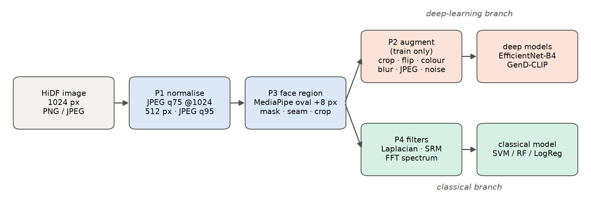
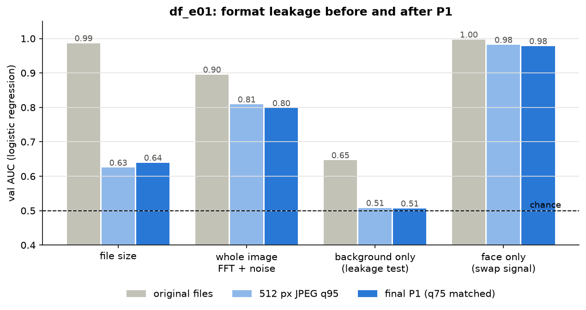
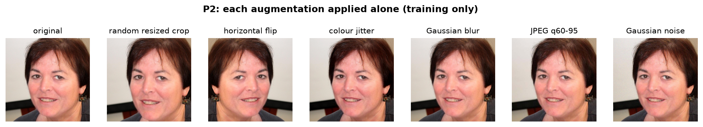
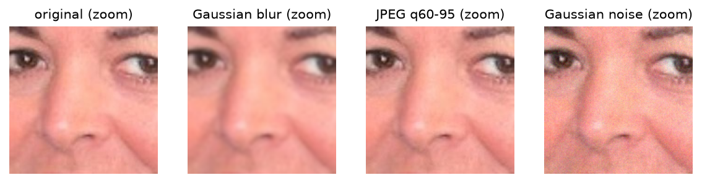
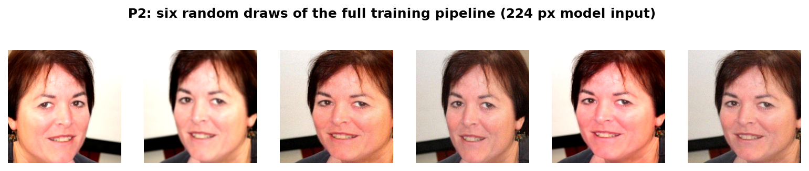
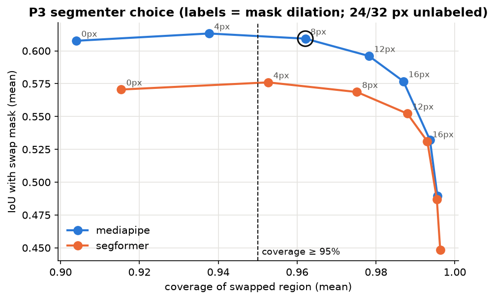
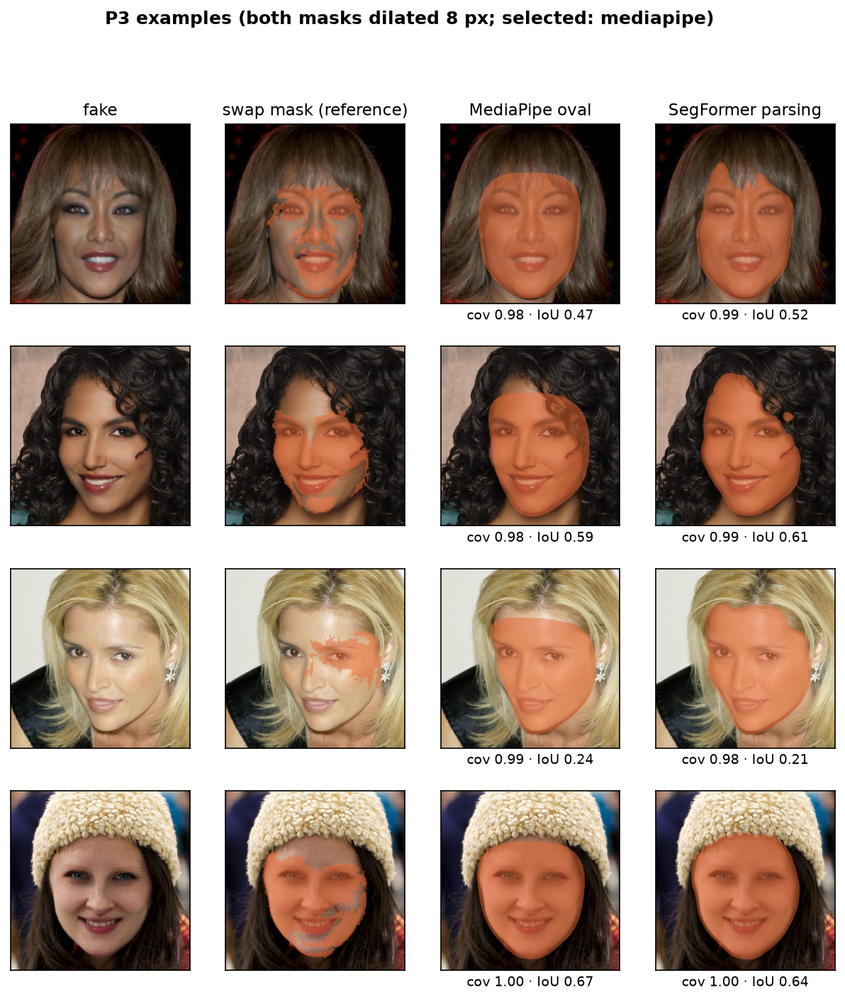
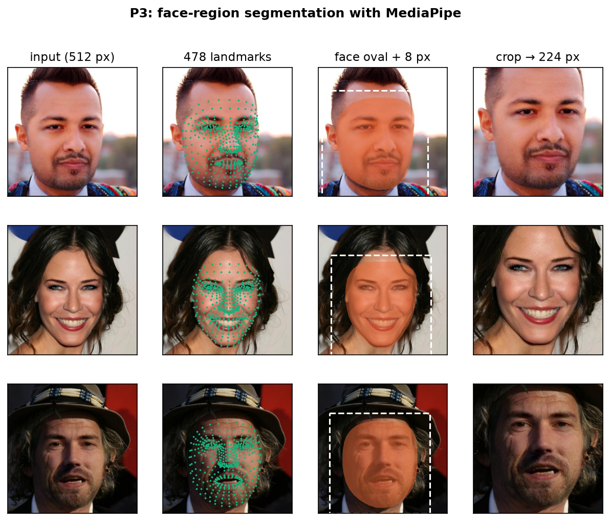
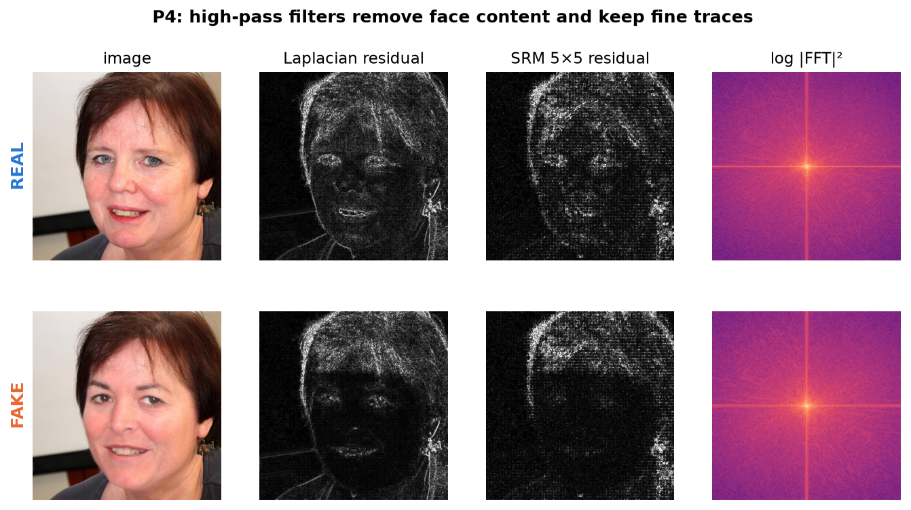
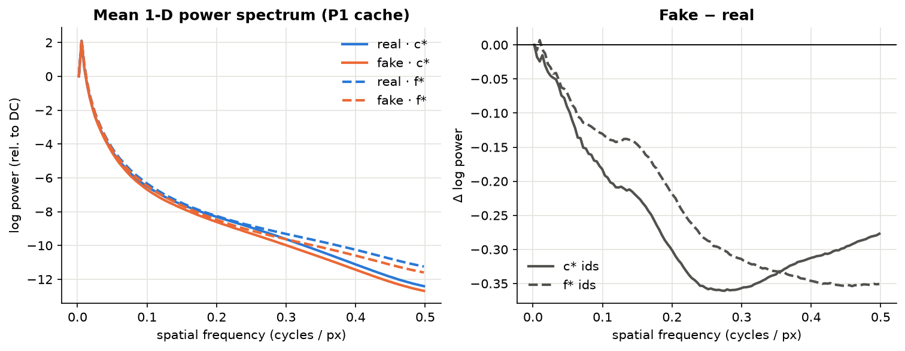

# Phase 2 — Preprocessing (P1–P4) and Leakage Check

Covers rubric criterion 3 (≥ 3 preprocessing methods for a 4-person team, each tied to a
problem in the data, with a pipeline diagram and before/after examples).
Figures: `documents/figures/phase2/`. Environment: `deepfake/.venv` (see `requirements.lock.txt`).

| ID | Method | Data problem it solves | Code |
|---|---|---|---|
| P1 | Compression-history matching + format normalisation | Each class was saved differently, so file size / compression predicts the label | `src/step5_build_cache.py` |
| P2 | Augmentation / noise addition (train only) | Swap traces are subtle and fragile; the model must not rely on one exact pixel pattern | `src/augment.py` |
| P3 | Face-region segmentation (MediaPipe) | A swap changes only the inner face (~11 % of pixels); background carries no signal | `src/face_regions.py`, `src/step7_*`, `src/step9_*` |
| P4 | High-pass / noise-residual / FFT filtering | Swap traces are high-frequency and hidden under face content; the classical model needs features | `src/features.py` |

---

## P1 — Compression-history matching (`df_e01_leakage_probe`)

### Problem
The four groups of HiDF images were saved with different encoders (JPEG quality estimated
from the quantisation tables, 300 files per group):

| Group | Original file | Median size |
|---|---|---|
| real `c*` | JPEG quality 75, 4:2:0 | 0.09 MB |
| fake `c*` | JPEG quality 99, 4:2:0 (built from the q75 real, saved again) | 0.26 MB |
| real `f*` | PNG (lossless) | 1.38 MB |
| fake `f*` | JPEG quality 99, 4:2:0 | 0.51 MB |

A logistic regression on **file size alone reaches 0.987 val AUC** (0.997 on `c*`, where both
classes are JPEG). The giveaway is the whole compression history, not just PNG vs JPEG.

### Method
Every image: RGB → **JPEG q75, 4:2:0 at 1024 px** (the lowest quality in the dataset, so
every image now carries one q75 compression) → resize to 512 px (Lanczos) → JPEG q95, 4:4:4.
Output `data/cache512/` (6.0 GB, 3.8 min on 6 workers). A first version without the q75 step
(`data/cache512_v1/`) is kept for comparison.

### Check: `df_e01_leakage_probe`
Logistic regression (standardised features) trained on 16K train images, AUC on the 9.6K val
images. Four probes:
- **file size**: log bytes (+ PNG flag on originals)
- **whole image**: FFT spectrum + whole-image noise-residual statistics (P4)
- **background only**: noise-residual statistics outside the P3 face mask. A fake's background
  is its real base's pixels re-saved, so this probe can only succeed through compression history
  → **the leakage test**
- **face only**: the same statistics inside the face mask → genuine swap signal

| Probe (val AUC) | Original files | 512 px JPEG q95 (v1) | **Final P1 (q75 matched)** |
|---|---|---|---|
| File size | 0.987 | 0.625 | 0.639 |
| Whole image FFT + noise | 0.896 | 0.809 | 0.798 |
| **Background only** | **0.647** | 0.508 | **0.507** |
| Face only | 0.997 | 0.982 | 0.978 |

Findings:
- On the original files, even the background predicts the label (0.65): compression history leaks.
- After P1 the background probe is at **chance (0.51)** for both `c*` and `f*`: the leak is gone.
- The remaining signal sits in the face: noise statistics inside the face alone give **0.98 AUC**.
  A swapped face is newly generated pixels whose noise does not match the camera noise of the
  rest of the image — a known forensic cue, and evidence the classical model will be strong.
- The leftover file-size signal (0.64) comes from the smoother fake face, not the format.
- v1 and q75 both pass the background test; q75 is kept because it halves the `f*`−`c*` gap of
  the file-size probe (0.15 → 0.09) and mirrors how images are re-compressed when shared online.

Full table incl. `c*` / `f*` columns: `experiments/df_e01_leakage_probe/results.csv`.

---

## P2 — Augmentation and noise addition

Applied to the training split only (`augment.train_transform`); val/test use a plain resize.
Order follows a real image pipeline: geometry → colour → blur → JPEG → sensor noise.

| Augmentation | Setting | p | Why |
|---|---|---|---|
| Random resized crop | scale 0.8–1.0, ratio 0.9–1.1 | 1 | Small framing changes |
| Horizontal flip | — | 0.5 | Faces are left/right symmetric |
| Colour jitter | brightness/contrast/saturation 0.2, hue 0.03 | 0.5 | Colour must not be a shortcut |
| Gaussian blur | kernel 7, σ 0.1–1.5 | 0.2 | Survive soft focus / downscaling |
| JPEG re-compression | quality 60–95 | 0.3 | Survive re-upload; don't depend on one compression level |
| Gaussian noise | σ 0.02 (0–1 scale) | 0.2 | Survive sensor noise |

Normalisation: ImageNet mean/std for CNNs, CLIP mean/std for CLIP models.
Tested as adjustment `df_e06` (with vs without).

---

## P3 — Face-region segmentation

### Reference without hand labels
HiDF has no segmentation labels. For a fake with a known real base, |fake − base| marks exactly
the swapped pixels: mean over RGB > threshold, morphological closing (5 px), largest connected
component, holes filled (`face_regions.swap_mask`).

### Candidate comparison (`step7_p3_segmenter_benchmark.py`)
2,000 train fakes; each segmenter sees **only the fake** (as at test time).
- coverage = |M ∩ S| / |S| — share of the swapped region inside the mask (main criterion;
  missing the blend seam loses the strongest cue)
- IoU = |M ∩ S| / |M ∪ S| — tightness
- Rule: highest mean IoU with mean coverage ≥ 0.95 (threshold 10); checked at thresholds 6 and 15.

| Method | Best dilation | Coverage | Coverage p10 | IoU | Speed |
|---|---|---|---|---|---|
| **MediaPipe Face Landmarker** (face-oval hull) | **8 px** | **0.962** | 0.931 | **0.609** | ~4 ms |
| SegFormer face parsing (CelebAMask-HQ) | 4 px | 0.953 | 0.925 | 0.576 | ~100 ms (MPS) |

MediaPipe has the higher IoU at every dilation and wins at all three thresholds
(thresh 6: dil 12, IoU 0.78; thresh 15: dil 8, IoU 0.31). Face parsing marks all skin up to the
hairline, while the swap covers mostly the inner face. Both detect a face in 100 % of the sample.
IoU depends strongly on the threshold because the swap mask is patchy (only strongly changed
pixels pass); coverage is stable at 0.96–0.97, which is why it is the main criterion.
SegFace was not added: it is the same model family as SegFormer (it would also over-mark skin)
and needs pickle weights plus extra code.

### Applied to all images (`step9_face_regions.py`)
- Faces detected in 69,450 / 69,476 images (99.96 %); the other 26 use the mean polygon
  (faces are aligned, so this is a sound prior).
- Face mask covers 32.2 % of fake and 32.0 % of real images — the mask itself is not a cue.
- Stored: face-oval polygons (`data/face_regions.npz`) and square crop boxes = mask bounding
  box + 15 % margin (`data/face_boxes.csv`; median 395 px, min 102 px).
- Derived regions used by P4: inner face, seam band along the mask edge, skin ring around it.

---

## P4 — High-pass, noise-residual and FFT features

Feature extractor for the classical model (`df_e03`) and the leakage probe; 247 features,
~73 ms per 512 px image.

| Group | Count | What it measures |
|---|---|---|
| `fft_*` | 128 | Azimuthally averaged log power spectrum over normalised frequency 0–0.5 cycles/px (Durall et al. 2020) |
| `res_*_all_*` | 16 | Std / mean-abs / skewness / kurtosis of 4 residuals (Laplacian, SRM 1st-order, SRM 2nd-order, SRM KV 5×5) over the whole image |
| `res_*_{face,out}_*`, `res_*_ratio_std` | 36 | Same statistics inside the face vs outside, and their ratio |
| `lbp_*` | 28 | Uniform LBP histograms (P=8,R=1; P=16,R=2) inside the face — skin texture |
| `col_*` | 30 | YCbCr + HSV mean/std inside the face vs the skin ring around it — colour mismatch |
| `seam_*` | 8 | Sobel gradient on the seam band vs inner face / outside — blending boundary |
| `face_area` | 1 | Mask size |

The mean spectrum shows fakes carry **less high-frequency power** than reals above
~0.05 cycles/px for both `c*` and `f*`, consistent with smoother generated faces.

---

## Outputs

| File | Content |
|---|---|
| `data/cache512/` | Final P1 cache (q75-matched, 512 px, JPEG q95) used by all experiments |
| `data/cache512_v1/` | First P1 version (no q75 step), kept for the df_e01 comparison |
| `data/p3_benchmark*.csv` | Segmenter comparison per image / summary |
| `data/face_regions.npz`, `data/face_boxes.csv` | P3 polygons and crop boxes for every image |
| `experiments/df_e01_leakage_probe/` | Probe features (parquet) and `results.csv` |
